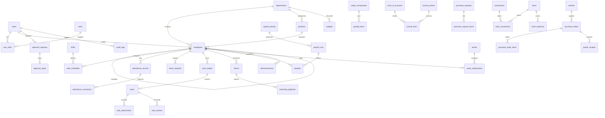

# Database Architecture & ERD — PT-MANAGEMENT-SISTEM

## 1. Overview Arsitektur Basis Data
Sistem menggunakan satu basis data relasional PostgreSQL `pt_management_sistem`. Skema dinormalisasi hingga 3NF, dilengkapi foreign key constraints, index pencarian, unique index, constraint checks, dan snapshot JSONB untuk audit trail.

## 2. Diagram Relasi Entitas (ERD)

## 3. Daftar Domain Tabel Relasional
1. **Core:**
   - `users`: ID akun, email, password hash, status aktif, remember token.
   - `roles`: Kode role (`super_admin`, `hr_admin`, dll.), label, deskripsi.
   - `permissions`: Kode izin, kategori modul.
   - `role_permissions`: Pivot relasi role dan permission.
   - `user_roles`: Pivot relasi user dan multi-role.
   - `departments`: Kode divisi, nama, cost center, status.
   - `positions`: Jabatan, level grade, relasi departemen.
   - `company_settings`: Informasi legal PT, NPWP, alamat kantor, koordinat geofence kantor pusat.
   - `system_settings`: Key-value store pengaturan global, cutoff payroll, toleransi keterlambatan.
   - `notifications`: Notifikasi in-app untuk user.
   - `audit_logs`: Jejak audit append-only (`actor_id`, `event`, `auditable_type`, `auditable_id`, `old_values`, `new_values`, `ip_address`).

2. **HRIS & Attendance:**
   - `employees`: Biodata, NIK, tanggal lahir, tanggal bergabung, status (tetap/kontrak/magang), supervisor_id (self-FK).
   - `employee_contracts`: Riwayat kontrak kerja, tmt_mulai, tmt_selesai, file dokumen private.
   - `shifts`: Nama shift, jam masuk, jam pulang, toleransi keterlambatan (menit).
   - `work_schedules`: Penugasan shift per karyawan per tanggal.
   - `attendance_records`: Log absensi masuk/pulang, path selfie privat, latitude/longitude, jarak geofence, status (tepat waktu/terlambat/alpha), is_locked.
   - `attendance_corrections`: Pengajuan koreksi jam absensi + alasan + bukti.
   - `leave_types`: Tipe cuti (tahunan, sakit, melahirkan, izin penting).
   - `leave_requests`: Pengajuan cuti, tanggal mulai/selesai, alasan, status approval.
   - `leave_balances`: Kuota hak cuti tahunan per karyawan.

3. **Operations & Internship:**
   - `work_targets`: Sasaran bulanan departemen/karyawan.
   - `tasks`: Tugas harian, judul, deskripsi, deadline, prioritas, status (`TODO`, `IN_PROGRESS`, `WAITING_VERIFICATION`, `REVISION`, `APPROVED`).
   - `task_attachments`: Bukti file hasil pengerjaan tugas (private storage).
   - `task_reviews`: Catatan evaluasi supervisor, skor, instruksi revisi.
   - `interns`: Data siswa/mahasiswa magang, universitas, periode magang, pembimbing (employee_id).
   - `internship_logbooks`: Catatan aktivitas harian anak magang + approval pembimbing.
   - `internship_evaluations`: Penilaian akhir kompetensi dan rekomendasi.

4. **Payroll:**
   - `salary_components`: Komponen penerimaan/potongan gaji (gaji pokok, tunjangan makan, tunjangan transport, potongan kasbon, lembur, dll.).
   - `employee_salary_components`: Nilai komponen gaji yang berlaku per karyawan.
   - `payroll_periods`: Periode bulan/tahun payroll, tanggal cutoff, status (`DRAFT`, `CALCULATED`, `APPROVED`, `LOCKED_CLOSED`).
   - `payroll_runs`: Eksekusi batch penggajian per periode.
   - `payslips`: Slip gaji per karyawan (total pendapatan kotor, total potongan, take home pay net).
   - `payslip_items`: Snapshot breakdown detail setiap komponen per slip gaji.

5. **Finance & Accounting:**
   - `chart_of_accounts`: Nomor akun (CoA), nama akun, klasifikasi (Aset, Kewajiban, Ekuitas, Pendapatan, Beban).
   - `journal_entries`: Header jurnal transaksi (`entry_number`, `date`, `reference_type`, `reference_id`, `status: DRAFT/POSTED`).
   - `journal_lines`: Baris jurnal debet dan kredit (`account_id`, `debit`, `credit`). Wajib seimbang (Sum Debit = Sum Credit) saat posting.
   - `budgets`: Alokasi anggaran per departemen per tahun anggaran.
   - `reimbursements`: Klaim pengeluaran karyawan + bukti kuitansi.
   - `payment_requests`: Pengajuan pembayaran kas keluar.

6. **Procurement:**
   - `vendors`: Data supplier/vendor, NPWP, kontak, rekening bank.
   - `purchase_requests`: Permintaan pembelian dari departemen.
   - `purchase_request_items`: Detail barang, jumlah, estimasi harga.
   - `purchase_orders`: PO resmi yang diterbitkan ke vendor setelah PR disetujui.
   - `purchase_order_items`: Detail item pada PO.
   - `goods_receipts`: Catatan penerimaan fisik barang di gudang (pemeriksaan kondisi & quantity vs PO).

7. **Inventory & Asset:**
   - `warehouses`: Lokasi gudang atau ruang penyimpanan.
   - `items`: Master data barang, SKU, barcode, unit satuan, stok minimum.
   - `stock_balances`: Stok aktual per item per gudang.
   - `stock_movements`: Kartu stok historis (`movement_type: IN/OUT/ADJUSTMENT`, qty, referensi dokumen).
   - `assets`: Register aset tetap (kode barcode aset, serial number, tanggal perolehan, harga, nilai buku).
   - `asset_assignments`: BAST peminjaman/penugasan aset ke karyawan, tanggal serah terima, tanggal pengembalian, status clearance.
   - `maintenance_records`: Log pemeliharaan berkala atau servis perbaikan aset.

8. **General Affairs:**
   - `facility_requests`: Pengajuan sarana, ATK, atau fasilitas kantor.
   - `vehicle_schedules`: Peminjaman mobil/motor operasional kantor.

9. **Shared / Approval Engine:**
   - `approval_requests`: Header permohonan persetujuan dokumen (`document_type`, `document_id`, `requester_id`, `status`).
   - `approval_steps`: Langkah verifikasi per level (`approver_id`, `step_order`, `decision`, `notes`, `decided_at`).
